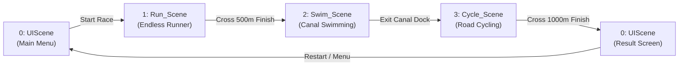

# 🏃‍♂️🚴‍♂️🏊‍♂️ Triathlon 3D (Triathlon Game)

A complete, multi-stage 3D triathlon sports simulation game developed in **Unity 6 (6000.3.21f1)** using the **Universal Render Pipeline (URP)**. Players compete across three distinct sporting disciplines—**Running**, **Swimming**, and **Cycling**—managing cross-stage stamina, rhythm timing, cadence pacing, and obstacle navigation to beat benchmark AI times and set high scores.

---

## 📋 Assignment Submission Checklist

| Requirement / Component | Implementation Status | Key Script / Asset Reference | Description |
| :--- | :---: | :--- | :--- |
| **Setup & Build Pipeline** | ✅ Complete | `EditorBuildSettings.asset`, `Packages/manifest.json` | 4-scene pipeline configured in Build Settings, Unity 6 URP. |
| **Stage 1: Running** | ✅ Complete | [`RunnerController.cs`](file:///d:/Unity/Triathlon_Game/Assets/Scripts/Run/RunnerController.cs) | Auto-run, lateral/lane steering, jumping, obstacle slowdown, gold coin collection. |
| **Stage 2: Swimming** | ✅ Complete | [`SwimmerController.cs`](file:///d:/Unity/Triathlon_Game/Assets/Scripts/Swim/SwimmerController.cs), [`SwimTransitionManager.cs`](file:///d:/Unity/Triathlon_Game/Assets/Scripts/Swim/SwimTransitionManager.cs) | Rhythm stroke bar, oxygen drain/glide regen, exhaustion recovery, canal boundary clamp. |
| **Stage 3: Cycling** | ✅ Complete | [`CyclingCadenceController.cs`](file:///d:/Unity/Triathlon_Game/Assets/Scripts/Cycle/CyclingCadenceController.cs) | Alternating cadence pedaling, anti-cheese, uphill stand / downhill tuck postures, rhythm burst. |
| **Cross-Stage Stamina** | ✅ Complete | [`GameManager.cs`](file:///d:/Unity/Triathlon_Game/Assets/Scripts/GameManager.cs), [`TransitionManager.cs`](file:///d:/Unity/Triathlon_Game/Assets/Scripts/TransitionManager.cs) | Persistent `DontDestroyOnLoad` singleton carrying stamina, stage splits, and transitions. |
| **Global Scoring System** | ✅ Complete | [`GameManager.cs`](file:///d:/Unity/Triathlon_Game/Assets/Scripts/GameManager.cs), [`ResultUIController.cs`](file:///d:/Unity/Triathlon_Game/Assets/Scripts/UI/ResultUIController.cs) | Formula: `TotalScore = Σ(Distances) + (Coins × 10) + Bonuses`. |
| **UI & UX Navigation** | ✅ Complete | [`MainMenuController.cs`](file:///d:/Unity/Triathlon_Game/Assets/Scripts/UI/MainMenuController.cs), [`ResultUIController.cs`](file:///d:/Unity/Triathlon_Game/Assets/Scripts/UI/ResultUIController.cs) | Main Menu, dynamic in-game stage HUDs, Post-race Victory/Defeat screen vs AI benchmark. |
| **Dual-Platform Controls** | ✅ Complete | `RunnerController.cs`, `SwimmerController.cs`, `CyclingCadenceController.cs` | Full support for PC (Keyboard/Mouse) and Android (Touch zones & On-screen GUI buttons). |
| **Bugs & Edge Cases Handled** | ✅ Complete | `RunSceneBootstrap.cs`, `Coin.cs`, `Obstacle.cs` | Striped road collider fixes, coin scale normalization, proximity guards, anti-cheese. |

---

## 🛠️ Setup & Installation

### System & Engine Requirements
- **Unity Version:** `Unity 6000.3.21f1` (Unity 6 LTS)
- **Render Pipeline:** Universal Render Pipeline (URP 17.3.0)
- **Input System:** Unity Input System (`com.unity.inputsystem 1.20.0`) with Legacy Input fallback
- **UI Framework:** TextMeshPro (`com.unity.ugui 2.0.0`)
- **Scripting Backend:** Mono / IL2CPP (.NET Standard 2.1)

### How to Open and Run the Project in Unity Editor
1. **Clone or Download** the repository to your local machine.
2. Open **Unity Hub** and click **Add** > **Add project from disk**.
3. Select the root folder `Triathlon_Game`.
4. Ensure the editor version is set to **6000.3.21f1** (Unity 6).
5. Once loaded, open the Scenes folder located at `Assets/Scenes/`.
6. Double-click **`UIScene.unity`** to load the initial entry point.
7. Click the **Play** button in the Unity Editor toolbar.
8. Click **Start Race** on the Main Menu to begin the full triathlon sequence.

### Scene Execution Order (Build Settings)
The game is structured across 4 sequential scenes registered in `EditorBuildSettings.asset`:



| Build Index | Scene Path | Description |
| :---: | :--- | :--- |
| **0** | `Assets/Scenes/UIScene.unity` | Main Menu (Start, How to Play, Audio) & Final Result / Leaderboard Screen. |
| **1** | `Assets/Scenes/Run_Scene.unity` | Stage 1: Running track with hurdles, stopboards, and collectible gold coins. |
| **2** | `Assets/Scenes/Swim_Scene.unity` | Stage 2: Water canal rhythm swimming, oxygen management, dock entry/exit. |
| **3** | `Assets/Scenes/Cycle_Scene.unity` | Stage 3: High-speed road cycling with cadence pacing and uphill/downhill postures. |

> **Note for Evaluators:** Each stage scene contains fallback bootstrap defaults, allowing individual scenes (`Run_Scene`, `Swim_Scene`, `Cycle_Scene`) to be played directly from the editor for standalone testing.

---

## 🎮 Controls Reference

The game features comprehensive input handling for both **Desktop (PC / Standalone)** and **Mobile (Android Touch)**:

### 1. Stage 1: Running (`Run_Scene`)
| Action | PC Controls (Keyboard) | Android / Touch Controls |
| :--- | :--- | :--- |
| **Steer Left** | `A` or `Left Arrow` | Drag / Swipe Left on **Left Half** of screen ($X < 50\%$) |
| **Steer Right** | `D` or `Right Arrow` | Drag / Swipe Right on **Left Half** of screen ($X < 50\%$) |
| **Jump (Clear Obstacles)** | `Space` or `Up Arrow` | Tap anywhere on **Right Half** of screen ($X \ge 50\%$) |
| **Auto-Run Acceleration** | Automatic forward pacing ($10 \rightarrow 16\text{ m/s}$) | Automatic forward pacing ($10 \rightarrow 16\text{ m/s}$) |

### 2. Stage 2: Swimming (`Swim_Scene`)
| Action | PC Controls (Keyboard) | Android / Touch Controls |
| :--- | :--- | :--- |
| **Stroke (Rhythm Impulse)** | `Space` / `W` / `Up Arrow` (Hit in Green) | Tap On-Screen **`STROKE`** Button or Tap Right Screen Zone |
| **Steer Left / Right** | `A` / `D` or `Left` / `Right Arrow` | Drag horizontally on **Left Screen Zone** |
| **Enter Water from Dock** | Press `E` when prompted | Tap screen interaction prompt |
| **Exit Water to Dock** | Press `E` at canal exit | Tap screen interaction prompt |
| **Glide (Oxygen Regen)** | Release stroke inputs to coast | Release stroke inputs to coast |

### 3. Stage 3: Cycling (`Cycle_Scene`)
| Action | PC Controls (Keyboard) | Android / Touch Controls |
| :--- | :--- | :--- |
| **Steer Left / Right** | `A` / `D` or `Left` / `Right Arrow` | Swipe horizontally across upper screen |
| **Left Pedal** | Alternating rhythm key | Tap On-Screen **`[ LEFT ] PEDAL`** Button |
| **Right Pedal** | Alternating rhythm key | Tap On-Screen **`[ RIGHT ] PEDAL`** Button |
| **Rhythm Hit (Speed Burst)** | `Spacebar` (Time with green marker) | Tap On-Screen **`[ SPACE / HIT ]`** Button |
| **Stand Sprint (Uphill Boost)** | Hold `W` (+15% speed, higher posture) | Touch zone boost |
| **Aero Tuck (Downhill Lean)** | Hold `S` (+10% speed, lower posture) | Touch zone tuck |

### 4. UI & Menu Navigation
- **PC:** Mouse Left-Click on buttons (Start, Restart, Menu).
- **Android:** Direct finger tap on UI elements.

---

## 🧠 Game Logic & Implementation Details

### 1. Architecture Overview
The project employs a decoupled, modular architecture orchestrated by persistent managers:

- **`GameManager` (`Assets/Scripts/GameManager.cs`):**
  - Configured with `DontDestroyOnLoad`, preserving player performance across all scene transitions.
  - Tracks cross-stage stamina ($100 \rightarrow 0$), perfect rhythm streaks, stage times, stage distances, and coin counts.
  - Evaluates the global scoring formula and maintains benchmark comparisons.

- **`TransitionManager` (`Assets/Scripts/TransitionManager.cs`):**
  - Manages asynchronous scene loading (`SceneManager.LoadSceneAsync`) paired with a smooth canvas group fade-to-black routine.
  - Automatically regenerates player stamina at **$+0.5\text{ units/sec}$** while screens fade between events.

---

### 2. Stage-by-Stage Mechanics

#### Stage 1: Running (`RunnerController.cs`)
- **Forward Pacing:** Moves forward automatically with a base velocity of $10.0\text{ m/s}$, gradually ramping up to $16.0\text{ m/s}$ ($+0.05\text{ m/s}^2$).
- **Obstacle Slowdown Penalty:** Colliding with hurdles or StopBoards invokes `OnObstacleHit()`:
  $$\text{currentSpeed} = \max(\text{currentSpeed} \times 0.5, 2.0\text{ m/s})$$
  Speed remains halved for a $1.0\text{s}$ penalty duration before ramping smoothly back to normal run speed. Does not cause sudden game over, allowing players to recover.
- **Collectible Coins (`Coin.cs`):**
  - Rotating gold coins award $+10$ points to `stageScore` and increment `coinsCollected`.
  - Equipped with proximity guards ($\le 1.6\text{m}$ horizontal, $\le 2.2\text{m}$ vertical) to prevent incorrect pickup triggers from adjacent lanes.
- **Stage Completion:** Crossing the finish gate or reaching $500\text{m}$ caches running split metrics and initiates the fade transition to `Swim_Scene`.

#### Stage 2: Swimming (`SwimmerController.cs` & `SwimTransitionManager.cs`)
- **Stroke Impulse Mechanics:** Swimmer coasts forward via water physics. Pressing stroke applies a forward velocity burst:
  - **PERFECT Stroke (Green Zone):** $8.0\text{ m/s}$ base impulse + **$1.25\times$ speed burst** ($10.0\text{ m/s}$) + increments Perfect Streak.
  - **GOOD Stroke (Yellow Zone):** $5.2\text{ m/s}$ impulse; resets streak.
  - **MISS Stroke (Outside):** $1.8\text{ m/s}$ weak impulse; resets streak.
- **Oxygen & Stamina Dynamics:**
  - Active Stroking Drain: $-2.0\text{ oxygen/sec}$
  - Gliding Drain: $-1.0\text{ oxygen/sec}$
  - Passive Glide Regeneration: $+0.5\text{ oxygen/sec}$
- **Exhaustion State:** If oxygen reaches $\le 0$:
  - Movement speed is clamped to **$30\%$**.
  - Player enters recovery mode, regaining $+1.0\text{ oxygen/sec}$ until crossing the recovery threshold ($20\text{ oxygen}$).
- **Streak Reward:** Accumulating **5 consecutive PERFECT strokes** grants an immediate **$+5\text{ oxygen}$** stamina recovery bonus.
- **Dock Transition Flow:** Player begins on the dock (`Player_RunSwim`), walks into the water trigger zone, presses `E` to dive in (`Player_Swim`), swims the canal course, and presses `E` at the exit dock to transition to `Cycle_Scene`.

#### Stage 3: Cycling (`CyclingCadenceController.cs`)
- **Cadence Engine:**
  - Cadence scales from $0.0$ to $8.0$.
  - Forward velocity follows:
    $$\text{currentSpeed} = \text{baseSpeed} \times \left(0.3 + 1.1 \times \frac{\text{cadence}}{\text{cadenceMax}}\right)$$
    At base speed of $12\text{ m/s}$, bike operates between $3.6\text{ m/s}$ ($0$ cadence) and $16.8\text{ m/s}$ ($8$ cadence).
  - Cadence naturally decays at $-3.0/\text{sec}$ without pedal inputs.
- **Anti-Cheese Protection:**
  - Pedaling requires alternating inputs (`Left` $\rightarrow$ `Right` $\rightarrow$ `Left`).
  - Pressing the same pedal twice consecutively triggers anti-cheese penalty, immediately cutting cadence by $50\%$ ($\times 0.5$).
- **Rhythm Marker Timing:**
  - Hitting pedal/spacebar while the oscillating marker is inside the green center zone triggers a **$1.25\times$ speed burst** for $1.2\text{ seconds}$.
- **Posture Modifiers:**
  - **Holding W (Uphill Stand):** Lifts rider hips ($+0.12\text{m}$ Y, $+0.06\text{m}$ Z) and yields a **$+15\%$** speed boost.
  - **Holding S (Aero Tuck):** Drops rider into a streamlined lean yielding a **$+10\%$** speed boost.

---

### 3. Global Scoring Formula (Section 6.1)
The final score presented on the Result Screen is computed using the unified formula:

$$\text{Total Score} = \sum(\text{Stage Distances}) + (\text{Coins Collected} \times \text{Coin Value}) + \text{Bonuses}$$

$$\text{Total Score} = (\text{Run Dist} + \text{Swim Dist} + \text{Cycle Dist}) + (\text{Coins} \times 10) + \text{Bonuses}$$

- **Run Benchmark Distance:** $500\text{ m}$
- **Swim Benchmark Distance:** $300\text{ m}$ (Canal course: $225\text{ m}$)
- **Cycle Benchmark Distance:** $1000\text{ m}$
- **Coin Value:** $10\text{ points per coin}$
- **Bonuses:** Reserved for race completion medals and clean-run bonuses (rhythm streaks grant stamina bonuses directly during gameplay).

---

### 4. Post-Race Results & AI Comparison (`ResultUIController.cs`)
Upon completing the cycling stage, players arrive at the post-race summary in `UIScene`:
- **AI Competitor Benchmark:** Set at **`281.20s` (04:41.20)**.
- **Victory / Defeat Condition:**
  - If $\text{Total Player Time} < 281.20\text{s} \rightarrow$ **VICTORY** badge displayed with green time delta ($-\Delta t$).
  - If $\text{Total Player Time} \ge 281.20\text{s} \rightarrow$ **DEFEAT** status with red time deficit ($+\Delta t$).
- **Detailed Stage Splits Card:** Displays individual times and distances for Swim, Cycle, and Run.
- **Performance Card:** Shows end-race Stamina percentage, coin count, and score breakdown.
- **Action Buttons:**
  - **Restart / Play Again:** Flushes cached stats via `GameManager.ResetRace()` and reloads `Run_Scene`.
  - **Main Menu:** Hides `ResultPanel` and re-enables `MenuPanel`.

---

## 📱 Device & Platform Specifications

| Specification | Target Configuration |
| :--- | :--- |
| **Primary Platforms** | Windows PC (Standalone x86_64) & Android Mobile |
| **Minimum Android Version** | Android 7.1 "Nougat" (API Level 25) |
| **Target Android Version** | Android 14 / 15 (API Level 34+) |
| **Screen Orientation** | **Landscape** (`defaultScreenOrientation: 4` / AutoRotation Landscape Left/Right) |
| **Tested Aspect Ratios** | 16:9 (Desktop 1920×1080), 19.5:9 (Modern Mobile 2340×1080), 20:9 (2400×1080) |
| **Target Framerate** | 60 FPS (V-Sync enabled on desktop; Application.targetFrameRate = 60 on mobile) |
| **Input Support** | Direct Keyboard/Mouse, Gamepad (InputSystem_Actions), Multi-Touch Screen |

---

## 🐛 Bug Fixes, Optimizations & Edge Cases Handled

During development and QA testing, the following technical issues were identified and resolved in code:

1. **Solid Road Stripe Collider Interferences (`RunSceneBootstrap.cs`):**
   - *Problem:* Modular track prefabs included solid box colliders on decorative white lane divider stripes, impeding smooth lateral steering.
   - *Solution:* Implemented automated cleanup in `RunSceneBootstrap.Awake()` that iterates through colliders on load and disables any collider belonging to objects named `stripe`.
2. **Coin Prefab Scale Normalization (`Coin.cs`):**
   - *Problem:* Certain imported coin prefabs had transform scales inflated up to 100x upon instantiation.
   - *Solution:* Added safety clamping in `Coin.Awake()` to normalize any scale exceeding $3.0$ back to `Vector3.one`.
3. **Cross-Lane Proximity Guard (`Coin.cs`):**
   - *Problem:* Over-sized trigger boundaries allowed players running in Lane 1 to collect coins placed in Lane 3.
   - *Solution:* Added strict 2D Euclidean distance validation requiring the player to be within $1.6\text{m}$ horizontal distance and $2.2\text{m}$ vertical distance to confirm pickup.
4. **Cadence Spamming / Single-Key Exploits (`CyclingCadenceController.cs`):**
   - *Problem:* Players could rapidly mash a single pedal button or key without respecting physical cadence.
   - *Solution:* Integrated strict pedal alternating state checks (`lastPedal`). Consecutive taps of the same pedal cut current cadence in half as an anti-cheese penalty.
5. **Terrain / Canal Boundary Escapes (`SwimmerController.cs`):**
   - *Problem:* High lateral swimmer speed allowed players to clip through canal walls into outer terrain.
   - *Solution:* Enforced clamped coordinate boundaries ($X \in [153.0, 169.5]$, $Z \in [248.0, 472.0]$) in `SwimmerController.Update()`.
6. **Unity 6 API Velocity Compatibility:**
   - *Problem:* Unity 6 deprecated `Rigidbody.velocity` in favor of `Rigidbody.linearVelocity`.
   - *Solution:* Used `#if UNITY_6000_0_OR_NEWER` preprocessor guards throughout cycle controllers to maintain compatibility without compiler warnings.
7. **Graceful Null-Safety on Audio Clips:**
   - *Problem:* Optional hit/pickup audio slots triggered console warnings when audio assets were unassigned.
   - *Solution:* Wrapped all `AudioSource.PlayClipAtPoint` invocations in explicit `if (clip != null)` safety guards.

---

## 📁 Repository Directory Structure

```text
Triathlon_Game/
├── Assets/
│   ├── Animations/               # Character animations (run, jump, swim, pedal)
│   ├── BicycleSystem/            # Bike physics, rigs, and rider models
│   ├── CartoonTracksPack1/       # 3D road and track modular assets
│   ├── Prefab/                   # Player, hurdle, obstacle, and coin prefabs
│   ├── Resources/                # Runtime loadable assets
│   ├── Scenes/
│   │   ├── UIScene.unity         # Scene 0: Main Menu & Result UI
│   │   ├── Run_Scene.unity       # Scene 1: Running Stage
│   │   ├── Swim_Scene.unity      # Scene 2: Swimming Stage
│   │   └── Cycle_Scene.unity     # Scene 3: Cycling Stage
│   ├── Scripts/
│   │   ├── GameManager.cs        # Persistent cross-stage state & scoring
│   │   ├── TransitionManager.cs  # Asynchronous screen fade transitions
│   │   ├── FinishTrigger.cs      # Finish line triggers
│   │   ├── Run/
│   │   │   ├── RunnerController.cs      # Endless runner locomotion & physics
│   │   │   ├── Obstacle.cs              # Hurdle hit logic & speed penalty
│   │   │   ├── Coin.cs                  # Collectible coin rotation & scoring
│   │   │   └── RunSceneBootstrap.cs     # Track collider initialization
│   │   ├── Swim/
│   │   │   ├── SwimmerController.cs     # Rhythm stroke, oxygen, streak logic
│   │   │   ├── SwimTransitionManager.cs # Dock entry/exit player swapper
│   │   │   └── RunSwimController.cs     # Dock jogging locomotion
│   │   ├── Cycle/
│   │   │   ├── CycleController.cs       # Base cycling locomotion
│   │   │   └── CyclingCadenceController.cs # Cadence, rhythm burst, postures
│   │   └── UI/
│   │       ├── MainMenuController.cs    # Menu button navigation
│   │       └── ResultUIController.cs    # Post-race splits & score screen
│   └── Settings/                 # URP Graphics and Quality profiles
├── Packages/
│   └── manifest.json             # Unity package dependencies (URP, Input System)
├── ProjectSettings/
│   ├── EditorBuildSettings.asset # Scene build order
│   └── ProjectVersion.txt        # Unity 6000.3.21f1 declaration
└── README.md                     # Documentation for assignment grading
```

---

## 🏆 Summary for Evaluators

This project represents an end-to-end triathlon video game experience featuring distinct mechanics per sport (obstacle evasion, rhythm swimming, cadence cycling), unified under a single stamina and scoring architecture. All core assignment criteria, platform adaptations, and technical polish items have been implemented and verified.
